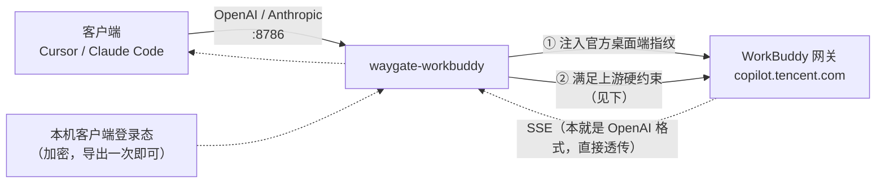

# waygate-workbuddy

<div align="center">

**把 WorkBuddy 订阅，变成一个本地 `base_url`**

[](https://www.npmjs.com/package/waygate-workbuddy)


[快速开始](#快速开始) · [命令](#命令) · [客户端怎么填](#客户端怎么填) · [工作原理](#工作原理) · [常见问题](#常见问题)

</div>

读取本机 WorkBuddy 桌面端的登录态，在本机起一个 **OpenAI / Anthropic 兼容**的聊天端点，
供 Cursor / Claude Code / Cherry Studio 等客户端直连。只在本机读写与转发，不上传任何数据。

## 快速开始

**要求**：Node.js ≥ 20；本机装有 WorkBuddy 桌面端**且已登录**。

```bash
# 全局安装（之后命令就是 wb）
npm i -g waygate-workbuddy

# ① 从客户端登录态导出（客户端登录态是加密的，需借客户端运行时解密一次）
node "$(npm root -g)/waygate-workbuddy/tools/wb-oauth-export.mjs"

# ② 导入
wb import wb-oauth.json

# ③ 启动
wb
```

启动后终端会打印**模型 ID 与代理地址**，把它们填进你的客户端即可。

> [!NOTE]
> 导入的 `wb-oauth.json` **等同账号登录态** —— 别提交进版本库，导入后删掉本地副本。

## 命令

```bash
wb                       # 启动反代（同 wb serve），打印模型 ID 与代理地址
wb models                # 只列出模型 ID（不起服务）
wb checkin               # 签到代领 + 跑成长任务 + 连登兑换
wb status                # 只查签到状态（不领取）
wb import <文件>      # 导入客户端登录态
wb doctor                # 自检：端口 / 登录态 / 模型清单 / 上游连通 / 令牌刷新
```

| 参数 | 说明 |
| --- | --- |
| `--port <n>` | 监听端口（默认 8786） |
| `--host <addr>` | 监听地址（默认 `127.0.0.1`） |
| `--key <sk-…>` | 指定入站密钥（默认自动生成并缓存） |
| `--json` | 机器可读输出 |
| `--verbose` | 打印每个请求的路由日志 |

## 客户端怎么填

**Cursor / Cherry Studio / OpenAI SDK**

- Base URL：`http://127.0.0.1:8786/v1`
- API Key：启动时打印的 `sk-wb-…`
- 模型：模型 ID（如 `deepseek-v4.1-flash`）

**Claude Code**

```bash
ANTHROPIC_BASE_URL=http://127.0.0.1:8786
ANTHROPIC_API_KEY=sk-wb-…
```

暴露的端点：`POST /v1/chat/completions` · `POST /v1/messages` · `GET /v1/models` · `GET /healthz`

支持流式（SSE）与非流式（`stream: false` 时自动聚合为单个 JSON）。

## 工作原理



**上游本身就是 OpenAI 兼容** —— 所以没有协议翻译层，出站 SSE 直接透传。
本工具真正做的事是三件：

1. **注入官方桌面端指纹**：`X-Product`（取 deploymentType，实测 `SaaS`）、`X-IDE-*`、
   `X-Agent-Intent: craft`、`X-Private-Data: true`、`X-CodeBuddy-Request: 1` 等 —— 缺失时
   用量不会归因到 WorkBuddy 使用端。
2. **满足上游的隐形硬约束**（实测得到的 400 来源，违反即整条挂）：
   - `stream: false` → 400（上游只认流式）
   - `max_tokens < 16` → 400
   - role 精确为小写 `developer` → 400
   - **system 正文命中「长 n-gram 模板指纹」**（Claude Code 血统的 git 环境模板行）→ 400
     ⇒ 本工具对模板行做**语义等价改写**（可关：环境变量 `WB_PROMPT_REWRITE=off`）
3. **管理登录态**：access 约 28 天，提前 2 天自动刷新；刷新会**轮换 refresh token**，已自动写回。

**安全**：入站密钥绝不出站（用 allowlist 而非 blocklist —— 失效模式是「少带一个头」而不是「密钥外泄」）；
出站凭证只存在本机 `~/.waygate/wb/`（0600）。

## 常见问题

**Q：为什么不能直接用 API 密钥（`ck_`）？**
A：实测桌面端登录态可打通聊天/清单/签到全部链路，一处凭证够了；不必让用户去后台自签密钥。
（若你的场景确实需要 `ck_`，本工具的指纹与改写模块可直接复用 —— 它们与凭证无关。）

**Q：登录态过期了怎么办？**
A：约 28 天。重跑一次导出 + 导入即可（两条命令）。`wb doctor` 会显示剩余时长。

**Q：`checkin` 报「未完成」的任务？**
A：那是任务的前置条件没满足（多为「体验 XX」型）。工具**如实记 `skipped`，不伪造行为去凑**。

**Q：会让我的桌面端掉线吗？**
A：实测**不会** —— 刷新后旧 access token 仍有效（官方插件刷新链，多会话共存）。
与 MiniMax/Qoder 的「同账号互相踢」不同。

**Q：`WB_PROMPT_REWRITE` 是什么？**
A：system 提示改写档位（`template`（默认）/`neutral`/`off`）。
上游调整了模板指纹规则、而本工具的规则还没跟上时，可设 `WB_PROMPT_REWRITE=off` 关掉它排查；
`neutral` 则把 system 整段换成中性提示（更激进）。

## 免责声明

本工具仅供**个人**在本机使用自己的订阅，不提供任何服务端能力、不代管他人凭证。
使用者需自行确认其行为符合 WorkBuddy 的服务条款。作者不对因使用本工具产生的任何后果负责。

## 相关项目

- **[waygate-qoder](https://github.com/zhanghaojie513/waygate-qoder)** —— 同款工具，对应 Qoder CN（`npm i -g waygate-qoder`）
- **[waygate-mmcode](https://github.com/zhanghaojie513/waygate-mmcode)** —— 同款工具，对应 MiniMax Code（`npm i -g waygate-mmcode`）
- **[waygate-core](https://github.com/zhanghaojie513/waygate-core)** —— 三个工具共用的骨架（`npm i waygate-core`）
- **[waygate-open](https://github.com/zhanghaojie513/waygate-open)** —— 同一作者的完整多提供商反代（含控制台、用量统计）

## License

MIT
